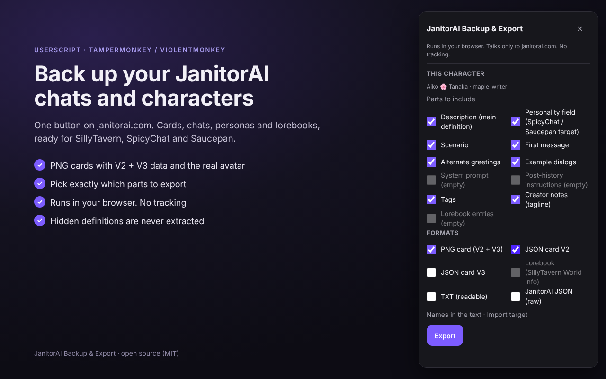
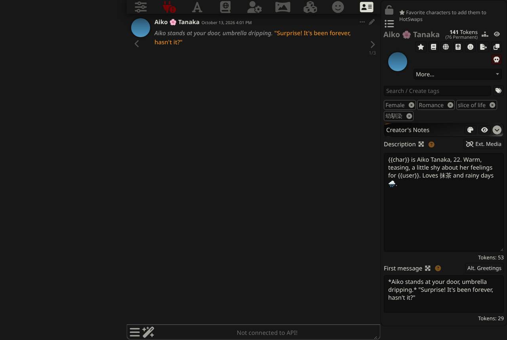
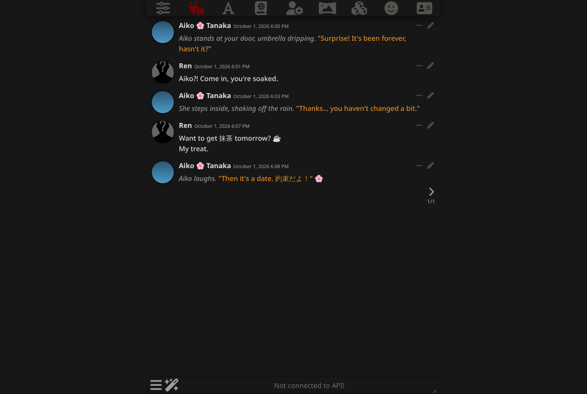

# JanitorAI Backup & Export

**The reliable JanitorAI backup & migration kit.** A userscript (Tampermonkey or Violentmonkey) for janitorai.com. It saves your chats, your characters, your personas and lorebooks, and public character cards, in formats that import into SillyTavern and the other roleplay apps people are moving to.

- **Runs entirely in your browser.** It talks only to janitorai.com and its image server, using your own login.
- **No tracking, no analytics,** nothing is sent anywhere else.
- **Hidden definitions are never extracted.** If a creator hid a character's definition, you get the public parts and a plain note saying why.

> **Install from [Sleazy Fork](https://sleazyfork.org/en/scripts/600237-janitorai-backup-export-chats-character-cards-lorebooks-to-sillytavern-spicychat-saucepan).** Status: v1.0.1, tested live on desktop Firefox. See [What still needs a real-world check](#what-still-needs-a-real-world-check).



## What's new

**1.0.1**: script icon; new Sleazy Fork page (banner, screenshots, FAQ).

**1.0.0**: first release.
- Character cards: PNG with both `chara` (V2) and `ccv3` (V3) chunks, V2/V3 JSON, TXT, and raw JanitorAI JSON. Lorebooks are embedded or exported as SillyTavern World Info.
- Chats: SillyTavern JSONL, Markdown, TXT, HTML, and full JSON with swipes. "Card + chat" comes as one ZIP.
- "Export all my chats" and "Back up everything", with throttling, retry, resume and a `skipped.json` report.
- Export buttons on every card in My Characters, favorites and creator pages.
- Personas in SillyTavern's backup format.
- Panel in English, Português (Brasil), Español and Bahasa Indonesia.

## Install

1. Install [Tampermonkey](https://www.tampermonkey.net/) or [Violentmonkey](https://violentmonkey.github.io/). On Android, use Firefox with Tampermonkey.
2. Open the script on **[Sleazy Fork](https://sleazyfork.org/en/scripts/600237-janitorai-backup-export-chats-character-cards-lorebooks-to-sillytavern-spicychat-saucepan)** and click **Install this script**. (Sleazy Fork syncs from [`janitor-backup-export.user.js`](janitor-backup-export.user.js) on `main`.)
3. Open janitorai.com. A **⤓ Backup / Export** button appears in the corner. You can drag it anywhere.

## Use

| Where | What you get |
|---|---|
| A character page | A checklist of every part (description, scenario, first message, alternate greetings, example dialogs, system prompt, post-history, tags, creator notes, lorebook). Untick what you don't want, then pick the formats. |
| A chat page | The chat as SillyTavern JSONL, Markdown, TXT, HTML or JSON, optionally zipped with the character card. |
| My Characters, favorites, creator profiles | A small ⤓ button and a checkbox on every card, plus "Export selected" and "Export all on this page" in the panel. |
| Anywhere, logged in | **Export all my chats**, **Back up everything**, **Export personas**. |

**Options:**
- *Names in the text*: keep the original text (the default), or use `{{char}}`/`{{user}}`.
- *Import target*: SillyTavern (the default), or SpicyChat/Saucepan, which also copies the main text into the card's `personality` field.
- *Settings*: default formats, file name template (`{name} - {creator} - {date}`), speed, language.

### Back up everything

One ZIP:

```
characters/   <name> - <creator> - <date>.png / .card.json / .janitorai.json
              (characters you chatted with, plus the ones you created,
               remembered from your visits to My Characters)
chats/<character>/   <character> - chat <id> - <title> - <date>.jsonl / .json
personas/personas.json   SillyTavern persona backup
lorebooks/    <title> - <id>.json   SillyTavern World Info
manifest.json counts, versions, date
skipped.json  every item that could not be saved, and why
```

### Import into SillyTavern

1. **Character first.** In Characters, use *Import Character from File* with the `.png` (or `.card.json`). SillyTavern offers to import the tags.
2. **Then the chat.** Open that character, then *Manage chat files → Import chat* with the `.jsonl`. SillyTavern only creates a character's chat folder once the character has been opened, so importing a chat before that fails.
3. **Lorebooks** are inside the card. SillyTavern asks to import the embedded lorebook the first time you open the character. Separate `.lorebook.json` files go in *World Info → Import*.
4. **Personas:** *Persona Management → Restore* with `personas.json`. SillyTavern restores names and descriptions but not pictures, so it reports "restored with warnings". Upload the persona pictures from the ZIP by hand.

| | |
|---|---|
|  |  |
| Card imported into SillyTavern 1.19.0 | JSONL chat imported: 5 messages, names, emoji and CJK intact |

The SillyTavern screenshots come from the automated test in `test/sillytavern/ui.test.js`. It drives SillyTavern's real UI with files the script produces from the test fixtures.

## Hidden definitions and privacy

These are hard rules, and the tests enforce them (`test/unit/guard.test.js`):

- If `showdefinition` is not exactly `true` and you are not the creator, the card is rebuilt **from a whitelist of public fields only**: name, picture, tagline, tags, creator, stats. That holds even if the server or the page carried more. The export says: *"The creator hid this character's definition, so only the public parts can be saved."* Lorebooks of such characters are not requested at all.
- **Logged out:** JanitorAI only sends definitions to logged-in users. Logged out, the definition fields come back `null` with `token_counts` at 0, even when `showdefinition` is true. The panel then says *"Log in to janitorai.com to save this character's definition — JanitorAI only sends it to logged-in users."*, and bulk exports list the character in `skipped.json` with the same reason.
- There is no proxy, no generation-payload capture and no probing. The source contains no `generateAlpha`, no reverse-proxy settings and no POST requests.
- The fetch hook only reads the `Authorization` header of the app's own janitorai.com requests, so the script can reuse your session. It never reads request or response bodies. Your login is found in this order: the Supabase cookie (`sb-auth-auth-token`, also split into `.0`, `.1`…), then localStorage, then that header.
- Every URL in the source is on janitorai.com (and `ella.janitorai.com` for avatars), except the GitHub issue link (only when you click "Report this") and the sponsor link (disabled, see below). `@connect` lists only the janitorai domains, and there is no `@require`.
- **Not a crawler.** JanitorAI's `robots.txt` disallows `/hampter/` for crawlers, and its firewall blocks headless browsers. The script runs only in your own browser and makes no API request until you click something (a test checks this). It works only on your own account and the pages you open.
- Bulk work is throttled conservatively. At most **2 requests are in flight**, and request starts are spaced **at least 1 s** apart (presets: 1 s / 1.5 s default / 3 s; no setting goes lower). 429/5xx get exponential backoff that honours `Retry-After`. If the site still answers 429, or answers 403, the run **pauses** with Resume instead of moving on to the next item.
- The UI is built with DOM APIs only (no `innerHTML`) inside a Shadow DOM host.

### Sponsor card

The code has one optional sponsor card (SPEC §7). It ships **disabled** (`SPONSOR_ENABLED = false`) until the offer is confirmed to allow userscript traffic. When enabled, it shows only after a successful export, inside the panel, at most once every 24 hours, with "Don't show again". The `@antifeature ads` line must be added in the same commit, and a test fails if the two disagree.

## Robustness

- **Layered data sources.** For characters: the JSON API (`/hampter/characters/<id>`), then the page state (`window._storeState_`), then the DOM (public data only). For chats: the authenticated `/hampter/chats/*` endpoints. Each layer has its own unit-tested parser.
- **Self-check.** When a layer fails, the panel names it (for example "JanitorAI changed its chat API (HTTP 404)") and links to a prefilled issue with no personal data. It never fails silently.
- **Card self-check.** Every card is validated against the V2/V3 schema checks before it is written.
- **Bulk runs:** retry with backoff, and failures go to `skipped.json`. A lost login, a firewall 403 or a persistent 429 pauses the run with **Resume** and **Save what we have**. You can cancel.
- **SPA navigation** is followed by watching the URL; nothing in the page's history API is patched.

## Verification

| Check | How | Status |
|---|---|---|
| PNG round-trip (`chara` + `ccv3`, UTF-8 with emoji/CJK, CRCs, chunk placement) | `test/unit/png.test.js` | ✅ automated |
| V2/V3 builders vs. schema-like checks | `test/unit/cards.test.js` | ✅ automated |
| API → card mapping: public, hidden, logged-out, NSFW, lorebook, alternate greetings | `test/unit/mapping.test.js`, `guard.test.js` on **synthetic** fixtures (the logged-out one is shaped from real data) | ✅ automated (fixtures need real captures, see below) |
| JSONL builder (header, swipes, `extra`, one record per line) | `test/unit/chat.test.js` | ✅ automated |
| Hidden-definition guard + "no proxy / payload capture" source scan | `test/unit/guard.test.js` | ✅ automated |
| Throttle ≤ 2 in flight and ≥ 1 s between starts, backoff, pause on 403/429, resume, ZIP, tokens, sponsor rules, listing claims | `test/unit/infra.test.js`, `sponsor-listing.test.js` | ✅ automated |
| Buttons on character, chat and list pages; download names and contents; bulk `skipped` report; logged-out notice; no requests before a click; phone layout; SPA; pt-BR | `test/browser/` (Playwright against mocked janitorai.com) | ✅ automated |
| PNG + JSON V2/V3 cards, JSONL chat and World Info import into **SillyTavern 1.19.0** | `test/sillytavern/import.test.js` (real server and its card parser) | ✅ automated |
| Card → open → chat import → 5 messages render; persona restore | `test/sillytavern/ui.test.js` (real SillyTavern UI) | ✅ automated |
| Real janitorai.com data, SpicyChat, Saucepan, Android Firefox | by hand | ⏳ see below |

### What still needs a real-world check

**First live run (2026-10-14, Firefox + Tampermonkey, logged in):** the button and panel appear on the home and character pages, and a public card exports correctly: the real avatar is re-encoded to PNG, both chunks are present, every definition field is filled, and SillyTavern's own parser reads it. It also found two bugs, both now fixed: a duplicate alternate greeting (JanitorAI adds a credit line to `first_message`) and a silent empty backup when the account has no chats. A second run with a real chat confirmed the chat API shape (`chatMessages` newest first, with `is_bot`, `is_main`, `message`, `created_at`): "Back up everything" saved the card and the chat with all 7 messages, and both imported into SillyTavern 1.19.0 with every message intact.

The build environment could not reach janitorai.com, SpicyChat or Saucepan, so the following have **not** been verified yet:

1. **Live janitorai.com smoke test, the rest** (owner, logged in): one own card (SPEC §9). A third run with a reroll confirmed swipes: on the latest turn every reply is `is_main: false` until the user writes again; the export keeps both as swipes with the newest selected, and SillyTavern loads them that way.
2. **Real API shapes.** The fixtures are synthetic (see [`test/fixtures/README.md`](test/fixtures/README.md)). Confirm:
   - the chat message fields (`is_bot`, `is_main`, `message`, `created_at`) and that `is_main: false` really marks rejected regenerations (they become swipes);
   - the lorebook entry fields inside `/hampter/script/<id>` → `script` (the mapper accepts `key`/`keys`/`keywords`, `content`/`text`, `comment`/`name`);
   - where personas live in `_storeState_`;
   - whether `/hampter/characters/<id>` returns the full definition to the **creator** of a hidden bot (SPEC §10.2). The guard allows it; the panel says so if the server doesn't return it;
   - whether any endpoint needs an extra header (one competitor sends `x-app-version`).
3. **Own characters in "Back up everything".** No "list my characters" endpoint is known. The backup includes characters you chatted with plus the ones seen on your My Characters page (visit it once and scroll).
4. **SillyTavern by hand** with a real export (current release), with screenshots in this README.
5. **SpicyChat import** of the PNG and JSON card, with both targets. Not checked at all.
6. **Saucepan import:** does it need `personality` filled ("Saucepan saw no personality field")? If yes, consider making the SpicyChat/Saucepan target the default. Not checked at all.
7. **Firefox for Android + Tampermonkey:** blob downloads, the fetch hook under Firefox's sandbox (`exportFunction`), avatar loading via `GM_xmlhttpRequest`, and the bottom sheet on a real phone. Also desktop Firefox and Violentmonkey.
8. **Native-speaker review** of the pt-BR/es/id panel strings and the 16 localized listing names and descriptions.
9. **SPEC §10:** the `showdefinition=true` share among ~50 trending bots, and JanitorAI's terms on automated access. Neither could be checked from here.

## Development

```
npm install            # playwright (uses PLAYWRIGHT_BROWSERS_PATH if set)
npm test               # unit tests (node --test)
npm run test:browser   # Playwright, mocked janitorai.com (CHROME_BIN=/path/to/chrome to use a system Chrome)
ST_DIR=/path/to/SillyTavern npm run test:sillytavern   # real SillyTavern (npm ci in ST_DIR first)
SCREENSHOTS=docs/screenshots npm run test:browser      # also refresh the screenshots
```

- One file, `janitor-backup-export.user.js`. The pure core (parsers, mappers, card builders, PNG writer/reader, ZIP writer, JSONL builder, manifest) is exported through a `module.exports` guard for Node tests. The browser layer below it is thin.
- `tools/sanitize-fixture.js` turns a real API capture into a shareable fixture.
- Semver: patch = fix, minor = feature, major = fundamental change.

## License

MIT, see [LICENSE](LICENSE).
